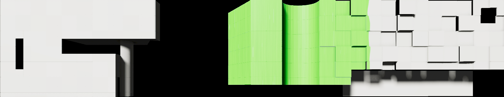
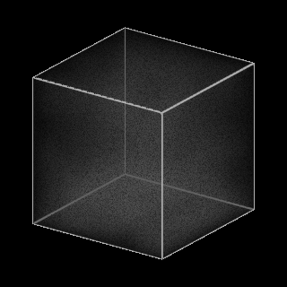
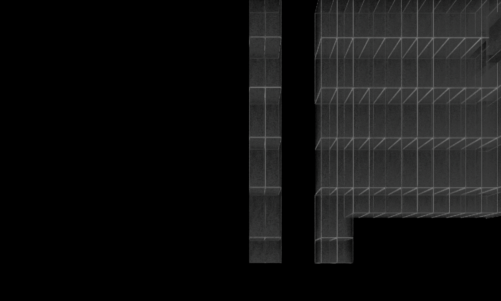
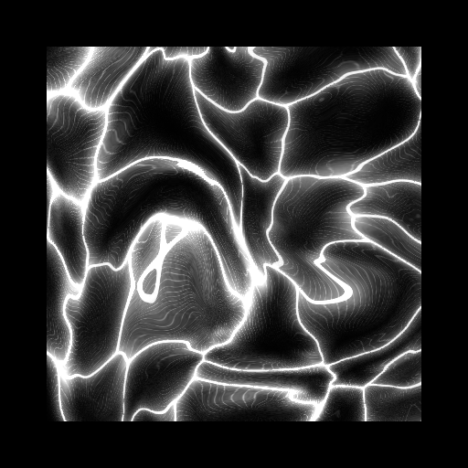
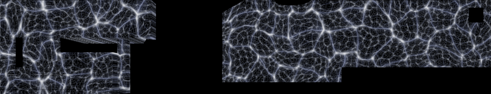
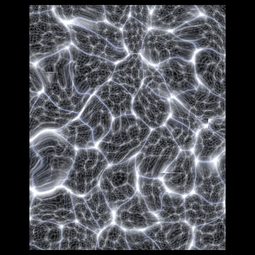
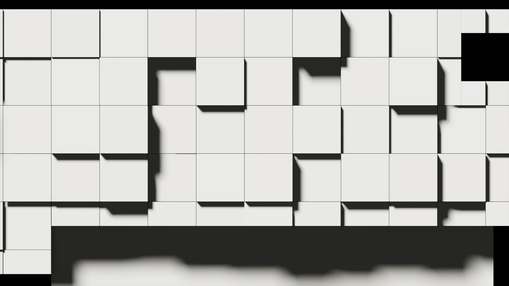

# Mudaac tile control

The controller is already attached to **Mudaac Model** in the Mudaac scene. Its **Tile Groups** checkboxes choose which existing surfaces receive effects. The default model has 231 candidates in ten architectural groups, with 222 selected. The nine **Undercroft panels**, including the large bottom-right panel, are unchecked by default. It never generates tiles or modifies source material assets.

The groups cover the left main facade, left low wall, **Left lower rounded wall**, **Left upper cantilever**, four entrance sections, right main facade, and undercroft. Both the lower rounded wall and upper cantilever are enabled by default. Expand any group for individual panel checkboxes. **Select** highlights all of a group's objects in the scene. Group and individual choices persist across refreshes, saves and recompilation; disabling a group restores its panels immediately.

1. Add any **Mudaac / Modifiers** components to Mudaac Model: Offset, Rotation, Scale, Noise Motion, Material, Tile Selector or Propagating Paint.
2. Create separate scene objects with **Mudaac / Influencers** components: Sphere, Axial, Progression or Noise. Assign them to a modifier's Influencers list. Unassigned or disabled influencers give full coverage.
3. Enable **Preview In Edit Mode** to see effects while editing, or enter Play Mode. To author panel placement, use **Stop Preview and Restore Tiles**, edit the panels, then use **Capture Current Tile Layout** under **Discovery Settings** to accept the new layout.

Modifiers run in component order, followed by components on **Global Modifiers** if assigned. Each frame starts from the captured authored pose, so effects stack without drift. Weight combines active influencers using Max, Average or Multiply, then blends with Influencer Weight and scales by Modifier Weight. Zero modifier weight is neutral.

Offsets and motion amplitudes use metres, ignoring imported transform scale. Choose Controller, Tile or World axes. Rotation uses degrees around each panel's own local axes; scale is a multiplier. Both keep the original mesh centre fixed, including panels whose object origin is off-centre.

Sphere has a local radius with transform scale controlling its world extent. Axial works around the influencer's local Y axis. The falloff curve maps normalized distance to influence. Progression sweeps along controller-local X/Y/Z across actual panel centres; 0 covers none and 1 covers all with the default curve. Combine Progression with Rotation for a flip sweep. Noise parameters vary the spatial mask over time.

All influencer randomness and Noise Motion use the shared `MudaacNoise` simplex field. X, Y and Z are sampled independently; animation uses a fourth time coordinate. Existing Random Scale/Random Speed and Spatial Scale/Frequency controls retain their values. **Noise / Seed** chooses a repeatable pattern and **Noise / Offset** moves it in noise coordinates. A zero animation speed freezes the pattern. Motion and rotation use separate noise channels. Noise is sampled at authored panel centres, so moving a panel does not feed back into its own weight.

New modifiers and influencers can expose `public MudaacNoiseSettings noise;` and call `noise.Sample01(position, scale, time, speed)` for weights, `noise.SampleSigned(...)` for signed values, or `noise.SampleVectorSigned(...)` for three independent motion channels. An optional final channel index selects a separate field. The static `MudaacNoise` API accepts already-scaled coordinates and animation time directly. This uses the project's existing Unity Mathematics dependency and allocates no per-sample objects.

Material controls blend a gradient color, HDR emission color, metallic and smoothness into per-renderer property blocks. They support the existing HDRP/Lit materials; unsupported properties are ignored. Original renderer and material-slot property blocks are restored when effects stop. For shaders requiring an emission keyword, enable emission on the source material yourself.

**Tile Selector** controls renderer visibility for tiles included by the controller. **Show Selected Only** shows selected tiles and hides the other included tiles; **Hide Selected** hides the selection while preserving the other tiles' current modifier output. Click **Select Tiles** in the modifier, then click panels directly in Scene view to toggle them without changing the Inspector selection. Shift-click adds, Ctrl/Cmd-click removes, and **Done Selecting Tiles** or Escape finishes. The selector's visibility effect pauses while picking so unselected tiles remain visible; selected tiles have cyan outlines and the hovered tile is yellow. Originally hidden tiles can still be picked through their bounds. Only one selector picks at a time, and closing its Inspector ends picking.

Use **Browse Tiles** for searchable checkboxes and **Frame** buttons inside the component. **All** selects every eligible tile, **None** clears the manual selection, and **Influencers Only** removes the manual filter. An untouched empty list still considers all included tiles for compatibility; an explicitly cleared selection considers none. **Manual References** retains access to the underlying list and **Select All When Empty** setting. Changes support Undo/Redo and prefab overrides. Shared selectors find tiles through controllers referencing their GameObject as **Global Modifiers**. Inspector command checks are in `Tests/MudaacTilePickerChecks.cs`; actual Scene view mouse/keyboard event checks are in `Tests/MudaacTilePickerSceneChecks.cs`.

Assigned influencers further filter the manual selection: the combined modifier/influencer weight must be positive and reach **Selection Threshold** (0.5 by default). With no active influencers, all listed tiles qualify. A zero Modifier Weight is neutral. Multiple selectors run in component order. Tiles excluded by the controller are unaffected, and hiding a renderer leaves its GameObject, scripts and colliders active.

Visibility resets to the captured authored state each frame and restores when the modifier is disabled or removed on the next evaluation, when preview stops, when the controller is disabled, on refresh or exclusion, and before saving or recompilation. Existing hidden renderers stay hidden after restoration. **Capture Current Tile Layout** also accepts intentional renderer visibility edits while preview is stopped. Visibility snapshots migrate automatically for existing tile selections. Selector regression checks are in `Tests/MudaacTileSelectorChecks.cs`.

Under **Discovery Settings**, use **Tiles Root** to restrict discovery, edit the name prefixes to include other surfaces, or assign **Explicit Tiles** to define the candidate list. Group and panel checkboxes still determine which candidates receive effects. A nonempty prefix list containing only blank strings matches nothing. **Refresh Tile Groups** rescans after hierarchy or shared material changes, preserving inclusion choices and captured poses. Use **Capture Current Tile Layout** to accept intentional transform edits while preview is stopped; calling it during an active effect restores the authored pose first. The known FBX panel IDs identify architectural sections; other matching names appear in **Other tiles**. Original poses are serialized for every candidate, including excluded panels, so reloads and Undo cannot replace them with preview transforms. Disabling the component or its GameObject restores all captured poses and bound material blocks; changing group or panel flags in code is detected at the next evaluation. Preview also restores before refresh, recompilation, Play Mode transitions and scene save, and after Undo/Redo. Effects own the bound transforms/property blocks while active, so avoid another script writing the same state.

Restoration regression coverage is in `Tests/MudaacTileRestoreChecks.cs`: edit-mode preview, component/GameObject disable, group and panel exclusion, renderer/material-slot overrides, Undo, lost transient bindings, intentional layout capture, saving and scene reload. Run through Unity MCP `execute_code` in Edit Mode; its temporary scene is removed afterward.

## Propagating paint

**Mudaac / Modifiers / Propagating Paint** is attached to Mudaac Model. Enable the controller's **Preview In Edit Mode**, use **Preview Paint** in the modifier Inspector, or enter Play Mode. Assign an **Origin** transform or drag the Scene view origin handle. **Additional Origins** supports up to sixteen origins in total.

**Tile Randomization** is the single spread-mode control:

- **0:** a continuous, world-space paint front, independent of panel boundaries. Splitting a surface into more tiles does not change its spread.
- **1:** whole tiles fill in a deterministic randomized order, starting at the origin tiles.
- **Between:** continuous paint blends into staggered tile fills.

All selected surfaces can fill, including sections separated by empty space. Paint only renders on the selected facade geometry. The field uses the authored pose, so other tile motion does not slide pigment across the panels.

**Organic Stroke Propagation** changes the travel field itself. **Stroke Propagation** blends from the round front at 0 to curving stroke lanes at 1. **Direction** uses world-space axes projected onto the controller's facade plane. **Stretch** lengthens growth along that direction; **Spacing** sets lane separation in metres. **Speed Variation** makes narrow tendrils run ahead of slower deposits. **Curvature**, **Branching**, **Scale** and **Sharpness** shape the paths. These controls combine with Tile Randomization and the independently animated spread noise.

The **Psychedelic Brush** preset sets up distorted pigment, cycling palette bands, stretched bristles and coarse grain. **Organic Strokes** sets up elongated, branching propagation with unequal lane speeds. Both Inspector buttons support Undo and preserve the three paint colours.

| Control | Effect |
| --- | --- |
| Spread Speed / Edge Softness | Automatic growth speed in metres per second; width of the growing edge |
| Spread Noise Amount / Scale | Edge distortion in metres; spatial frequency in inverse metres |
| Stretch | Independent XYZ frequencies for drips, bands or elongated pools |
| Octaves / Lacunarity / Persistence | Number of detail layers, frequency increase and strength of finer layers |
| Warp / Contrast | Bend the field into organic folds; increase its peaks and valleys |
| Speed / Drift | Evolve the spread field and move it in a chosen direction; zero Speed freezes spread noise |
| Seed And Offset | Repeatable spread pattern and tile randomization |
| Pigment colours / Scale / Contrast / Grain / Noise | Colour mixing and surface texture, independent of spread noise |
| Psychedelic / Colour Cycle Speed / Saturation | Repeating three-colour palette bands and vivid colour mixing |
| Pigment Distortion / Distortion Scale / Swirl Strength / Swirl Scale | Fold pigment coordinates into warped pools and curls |
| Brush Strength / Scale / Stretch / Angle | Bristle marks with adjustable frequency, elongation and direction |
| Brush Roughness / Grain Scale | Broken paint texture, uneven gloss and adjustable fine grain |
| Motion Speed / Pigment Flow / Marbling | Continuous colour motion, including after filling |
| Drying Time / Wet and Dry Smoothness / Motion When Dry | Transition from wet to dry paint and retain adjustable movement |

Disable **Automatic Spread** to scrub **Progress** manually. **Pause** freezes the paint clock; **Loop** starts another spread after **Filled Hold Time**. **Restart Paint** resets simulation time; manual Progress remains at its authored value. Animated spread noise can reveal and recede around the front. This is a procedural visual field rather than a persistent fluid simulation.

Extreme settings are available directly: Stroke Stretch reaches 40, Speed Variation reaches 8 (lane speeds from 1/16 to 256 times the base rate), Brush Stretch reaches 100, Brush Strength and Roughness reach 8, Psychedelic reaches 8, Swirl Strength reaches 32, Marbling reaches 16 and Grain reaches 4. Distortion and Warp have no Inspector upper limit. Spread noise supports eight octaves, Lacunarity up to 8 and Contrast up to 16. Shader paths preserve these expanded values rather than clamping them to the earlier ranges. Full Progress still fills the surface with extreme stroke parameters; progress uses a conservative bound on the travel field.

Paint temporarily uses the shared `Assets/Materials/MudaacPaint.mat` HDRP Lit material and per-renderer property blocks. It retains the original base colour, metallic and smoothness values; source texture and normal maps are not transferred. Disabling paint, stopping preview, excluding tiles, refreshing, saving and recompiling restore original materials and overrides. Attach the stateful paint modifier to its own controller rather than Global Modifiers.

Unity 6000.4.5f1 / HDRP 17.4.0: **23 paint checks** and **23 rendered checks** pass, covering both slider endpoints, mesh partition independence, independently animated spread noise, continued pigment motion, material restoration, directional stroke growth, speed variation, branching, brush rotation and finite rendered pixels at extreme settings. Run `Tests/MudaacPaintChecks.cs` and `Tests/MudaacPaintRenderingChecks.cs` through Unity MCP `execute_code` in Edit Mode. Player builds and installation GPU performance have not been measured. The shader uses [Shader Graph Custom Function file mode](https://docs.unity.cn/Packages/com.unity.shadergraph%4017.3/manual/Custom-Function-Node.html).

## Brush paint reveal

**Mudaac / Modifiers / Paint Reveal** reproduces the reference clip's adjacent, alternating brush swipes. It is attached to **Mudaac Model** with edit-mode preview enabled. Propagating Paint remains available as a separate modifier.

The effect projects continuous strokes across the selected surfaces in their authored pose. Tile boundaries do not restart the brush, and tile movement does not slide the pigment. The controller's existing group choices and influencers determine the affected surfaces.

| Control | Effect |
| --- | --- |
| Stroke Count / Stroke Overlap | Brush width and overlap between adjacent swipes |
| Brush Angle | Rotate the entire pattern in the controller's facade plane; zero gives vertical swipes |
| Start From Right / First Stroke Upwards / Alternate Direction | Stroke order and travel direction, relative to the controller's right/up axes |
| Edge Roughness / Stroke Speed Variation / Seed | Rough tips, stray bristles, uneven swipe timing and a repeatable pattern |
| Paint Color / Bristle Density / Bristle Strength | Solid pigment colour and fine lengthwise streaks |
| Dry Brush | Fine gaps showing the substrate; zero gives opaque paint |
| Paint Smoothness / Emission | Paint surface finish and optional glow |
| Automatic Reveal / Progress / Reveal Duration | Automatic timing, or manual scrubbing from clean to fully painted |
| Loop Mode | Once holds the finished paint; Restart clears between cycles; Paint And Erase brushes back to the original surface in the same stroke order |
| Painted Hold Time / Erase Duration / Empty Hold Time | Timing between painting, wiping and repeating |

Use **Restart Reveal**, **Pause/Resume**, and **Preview Reveal / Stop Preview And Restore** in the modifier Inspector. Restart resets automatic playback; manual Progress remains at its authored value. The Mudaac scene starts from the right of Front_Camera; its controller is rotated 180 degrees, so Start From Right is disabled there. This stateful modifier belongs on its own controller rather than Global Modifiers. Multiple material-replacement paint modifiers are evaluated in component order; use one at a time for predictable results.

`Assets/Materials/MudaacPaintReveal.mat` uses a separate HDRP Lit Shader Graph and `MudaacPaintReveal.hlsl`. The effect retains substrate base-colour overrides, metallic and smoothness; source texture and normal maps are not transferred. Original material slots and property blocks restore when the reveal is disabled, scrubbed to zero, erased completely, excluded, stopped, refreshed or saved. No video playback or reference-video asset is required at runtime.

Unity 6000.4.5f1 / HDRP 17.4.0: **22 integration checks** and **28 rendered checks** pass. They cover stroke order, alternating direction, monotonic coverage, rough tips, bristles, dry-brush gaps, rotation, seed/timing, mesh partition independence, weight blending, erasing, pause, extreme values and material restoration. Execute `Tests/MudaacPaintRevealChecks.cs` and `Tests/MudaacPaintRevealRenderingChecks.cs` through Unity MCP in Edit Mode. The production Front_Camera was also rendered at partial progress. Player builds and installation performance have not been measured.

## Liquid inter-tile seams

**Mudaac / Modifiers / Liquid Seams** is attached to **Mudaac Model** and uses the controller's selected surfaces when enabled. It recreates the reference's fine white liquid lines, dark cell interiors and moving pools at the corners, with optional parametric lines inside each tile. The scene retains the user's live Inspector tuning and enabled state.

Each selected tile supplies its authored rectangular footprint in the controller's right/up facade plane. Neighboring tile edges contribute to a shared distance field; smooth unions form rounded pools, including where one tile's corner meets the middle of a larger tile's edge. Nearby internal cell patterns also participate on both sides of the boundary, preventing clipped junctions. Moving Voronoi sites divide the tile interiors; their continuous sinusoidal motion avoids animated random-site jumps. Shared world-space noise moves the liquid bulges and ripples. Tile movement retains the authored coordinates. No particles, video playback or fluid simulation is used.

| Control | Effect |
| --- | --- |
| Seam Width | Fine liquid border on each side of the tile seam, in metres; zero removes thin edges, leaving thicker pools/bulges |
| Junction Radius | Round the dark corners to create wider pools where tiles meet |
| Flow Amount / Edge Roughness | Moving bulges and small ripples, in metres |
| Flow Scale / Speed / Direction / Seed | Spatial frequency, animation speed, facade-plane drift and repeatable variation |
| Interior Cell Count | Moving cells within each tile, up to twelve; zero or one leaves the tile undivided |
| Interior Line Width | Half-width in metres; zero removes thin internal lines while allowing thicker pools |
| Interior Curvature / Interior Motion | Bend internal lines; control site motion relative to Flow Speed |
| Liquid Color / Interior Color / Interior Blend | Liquid and cell colours; Interior Blend zero retains original tile base colours |
| Emission / Halo Width / Halo Strength | HDR brightness and a soft local halo; production bloom also affects appearance |
| Modifier Weight / Influencers | Existing tile weighting controls |

Use **Pause/Resume**, **Restart Flow**, and **Preview Liquid Seams / Stop Preview And Restore** in the modifier Inspector. Zero flow speed also freezes animation. Attach this stateful effect to its controller rather than Global Modifiers. Use one material-replacement effect at a time; the last modifier wins when several replace the same tile material.

`MudaacLiquidSeams.mat`, `MudaacLiquidSeams.shadergraph` and `MudaacLiquidSeams.hlsl` provide the HDRP Lit effect. There is one shared material and independent per-slot property blocks. Original material references and renderer/slot overrides restore when preview stops, the effect is disabled, tiles are excluded, or the scene saves. Original texture and normal maps are not copied into the temporary material. The effect draws on the selected tile surfaces, including their outer perimeter; it does not add geometry in empty physical gaps. Projected rectangular footprints approximate curved or nonrectangular panels rather than tracing arbitrary mesh contours.

Unity 6000.4.5f1 / HDRP 17.4.0: **26 integration checks** and **28 rendered checks** passed. They cover neighboring footprints, shared flow phase, time/pause/restart, parameter changes, parent movement, authored coordinates, per-slot colours, exclusion and restoration, visible seam width, T-junction pools, identical rendering from either neighbor's shader data, animated bulges, zero-width disappearance with roughness/halo, internal count/width/curvature/motion, colour, halo, original-colour mode and finite extreme values. Execute `Tests/MudaacLiquidSeamsChecks.cs` and `Tests/MudaacLiquidSeamsRenderingChecks.cs` through Unity MCP in Edit Mode. The initial effect was also inspected through Front_Camera; the refinement uses isolated rendered checks with unequal tiles and was inspected through Front_Camera. Each tile caches up to 128 nearby edge segments and 32 nearby internal patterns, retaining the closest entries for extreme neighborhoods. Player builds and installation GPU performance have not been measured.

## Wire volume

**Mudaac / Modifiers / Wire Volume** turns the existing tiles into fine box outlines with translucent faces and grainy interior mist. It is enabled on **Mudaac Model**, across the controller's selected tiles, with edit-mode preview enabled. The previous **Liquid Seams** component is retained and disabled. Tile selection, geometry and authored transforms are preserved.

Adjust the **Wire Volume** component in the Inspector:

| Controls | Effect |
| --- | --- |
| Edge Color / Width / Opacity / Brightness | Wire appearance; width is measured in metres, including on the imported model at scale 100 |
| Glow Width / Strength | Soft light around each wire; HDR edge colours and brightness can also feed the existing bloom |
| Rear Edge Opacity | Visibility of the far-side box edges through the interior |
| Volume Color / Face Opacity / Volume Density | Body tint, translucent surface presence, and interior fog density per metre |
| Bottom Density / Height Falloff | Extra mist near the bottom of each tile, using world up even on rotated panels |
| Noise Scale / Strength / Seed | Size, variation and repeatable pattern of the three-dimensional mist |
| Grain Scale / Strength | Fine texture on both the faces and interior mist |
| Drift | Noise-coordinate motion per second; `(0, 0, 0)` freezes the texture |
| Volume Samples | 1–12 interior samples per pixel; more samples improve fog integration and cost more GPU time |
| Opacity / Modifier Weight / Influencers | Overall transparency, blending from the source base colour, and spatial control through the existing influencer system |

**Reference Mist** restores the neutral, grainy cube preset; **Clean Wire** removes the faces and mist. **Preview Wire Volume / Stop Preview And Restore** toggles the controller preview. The saved facade uses Face Opacity `0.12` and Volume Density `0.25` to give its thin panels more presence; the general cube preset uses `0.025` and `0.15`. The shader reads the final renderer transform, so metre-based widths and world-up density also follow transform modifiers applied later in the stack. It works through **Global Modifiers**.

`Assets/Materials/MudaacWireVolume.mat` uses the HDRP Unlit graph `Assets/Shaders/MudaacWireVolume.shadergraph` and `MudaacWireVolume.hlsl`. It shares one effect material and writes per-slot property blocks. Front and rear box edges are derived analytically, without triangle diagonals or added edge objects. A short ray integration through each tile's local bounds supplies the mist. The graph uses transparent blending without depth writes and retains HDRP's Unlit base-colour exposure behavior.

Original material slots and renderer/slot property blocks restore through the controller when preview stops, a tile is excluded, weight reaches zero, or effects are refreshed, saved or disabled. A disabled Wire Volume modifier restores on the next controller evaluation. Avoid simultaneously enabling material-replacement effects such as Paint, Paint Reveal and Liquid Seams; the last material effect owns the tile shader.

The mist and far edges approximate a **box-shaped interior** within the existing mesh silhouette; curved or slanted panels keep their geometry. The effect does not add thickness or create physical smoke, lighting or self-shadowing, and assumes the camera views the tile from outside. Overlapping transparent tiles use normal renderer sorting. Source texture/normal maps are not carried into the source-colour blend; weight zero restores the actual source material.

Validated in Unity 6000.4.5f1 / HDRP 17.4.0: **22 integration checks** and **22 rendering checks** pass, including imported scale/rotation, influencers, global modifiers, restoration, rear wires, grain, fog, drift, extreme settings, the actual bevelled FBX panel, later rotation/nonuniform scaling, and the production 11.1 EV exposure. The production Front_Camera was inspected with the selected facade tiles using the effect. No Console errors or warnings were present. Run `Tests/MudaacWireVolumeChecks.cs` and `Tests/MudaacWireVolumeRenderingChecks.cs` through Unity MCP in Edit Mode. `Tests/GenerateMudaacWireVolumeGraph.py` regenerates the graph after the HLSL has been imported. Player builds and final installation performance have not been measured.

## Organic filaments

**Mudaac / Modifiers / Organic Filaments** creates animated cellular membranes, fine radial strands, soft mist and bright pulsing junctions throughout the selected tile surfaces. The recording's monochrome organic flow is the visual reference. It is attached to **Mudaac Model**, with edit-mode preview enabled on the existing 222 selected tiles. Previous modifier settings and enabled states are preserved; the new component runs last among the local modifiers and owns the visible tile material.

| Controls | Effect |
| --- | --- |
| Cell Size / Distortion / Cell Motion | Membrane spacing in metres, curvature and breathing movement |
| Tile Influence | Zero uses one continuous facade-wide field; higher values bend the pattern independently inside each tile, fading to zero with a flat slope at its projected boundaries |
| Membrane Width | Bright core width in metres; zero removes the core independently of strands and glow |
| Strand Strength / Density / Mist Strength | Fine radial fibres and a faint granular veil inside the cells |
| Glow Width / Strength / Junction Strength | Soft local halos and brighter cellular necks |
| Pulse Amount | Moving brightness variation across membranes, fibres and junctions |
| Filament Color / Brightness / Background Color | HDR Unlit appearance, independent of scene lighting and camera exposure |
| Background Blend | Zero retains each original material slot's base colour behind the filaments; one uses Background Color |
| Speed / Drift / Seed | Shape evolution, facade-plane travel and deterministic pattern variation |
| Modifier Weight / Influencers | Blend the effect per tile using the existing weighting system |

The facade is tuned to Cell Size `1.75`, Tile Influence `0.44`, Membrane Width `0.003`, Brightness `1.1`, Pulse Amount `0.9`, Strand Strength `0.8`, Glow Strength `0.25` and Junction Strength `2`. Other controls use the component defaults. **Pause / Resume**, **Restart Animation** and **Preview Organic Filaments / Stop Preview And Restore** are available in the Inspector. Disabling the modifier restores the preceding enabled effect on the next controller evaluation. Stopping controller preview restores the authored materials and property blocks.

`MudaacOrganicFilaments.mat`, `MudaacOrganicFilaments.shadergraph` and `MudaacOrganicFilaments.hlsl` provide an opaque HDRP Unlit material. One shared material and per-slot property blocks retain original base-colour overrides. Authored world coordinates keep the pattern attached when transform modifiers move the tiles. Moving cellular sites, layered domain distortion and radial fibres generate the image without particles or added geometry. Global Modifiers are supported, with independent animation clocks for each controller. Fine strands fade toward their average intensity when smaller than a pixel.

The field is projected onto the controller's right/up plane; rectangular projected footprints control the tile influence. Strong curvature or surfaces viewed edge-on can stretch the pattern. This is a surface effect: it does not create the reference's physical volume or fill empty gaps between tiles. Source texture and normal maps are not carried into the base-colour blend. Additional enabled material effects still evaluate, and the last material replacement in local/global component order wins.

Validated in Unity 6000.4.5f1 / HDRP 17.4.0: **28 integration checks** and **21 rendering checks** pass, covering influencers, global sharing and independent clocks, pause/restart, source material/slot restoration, imported scale and rotation, whole-interior coverage, seamless unequal-tile rendering at zero influence, pattern controls, finite extreme values, the actual bevelled FBX mesh and production 11.1 EV exposure. The production Front_Camera was inspected. Run `Tests/MudaacOrganicFilamentsChecks.cs` and `Tests/MudaacOrganicFilamentsRenderingChecks.cs` through Unity MCP; `Tests/GenerateMudaacOrganicFilamentsGraph.py` regenerates the graph after importing the HLSL. Scene and live tuning backups are in `.codex/backups/mudaac-organic-filaments-2026-10-15/`. Player builds and installation GPU performance have not been measured.

## Neural web

**Mudaac / Modifiers / Neural Web** renders the selected tiles as an animated cellular web: dark interiors, curved pale filaments, smaller nested networks and luminous junctions. `MudaacTileNeuralWebModifier` is enabled on **Mudaac Model** with edit-mode preview; 222 tiles were selected at validation. Existing effect components and their settings are retained.

| Controls | Effect |
| --- | --- |
| Cell Size | Largest cell size in facade-plane metres |
| Strand Width / Glow Width / Glow Strength | Filament cores and soft surrounding light; widths use metres |
| Layers / Fine Strength | One to three nested networks; fewer layers reduce GPU work |
| Distortion / Cell Motion / Seed | Curvature, animated site movement and repeatable pattern |
| Background / Strand / Junction Color / Brightness | Dark-cell palette, strand tint and bright nodes |
| Junction Strength / Grain Strength / Pulse Strength | Connecting lights, subtle filament texture and animated brightness |
| Animation Speed / Drift / Pause / Restart Animation | Playback; zero animation speed freezes the pattern |
| Modifier Weight / Influencers | Blend the complete effect per tile, sampling each tile's authored centre |

The pattern is continuous across the controller's facade plane and reconstructed from each mesh's authored pose, so transform modifiers carry the texture with their tile. Influencers control whole tiles rather than clipping filaments within a tile. It also supports **Global Modifiers**. Use one material-replacement effect at a time; the last enabled material modifier owns the final shader.

`Assets/Materials/MudaacNeuralWeb.mat` uses `Assets/Shaders/MudaacNeuralWeb.shadergraph` and `MudaacNeuralWeb.hlsl`. This opaque HDRP Unlit shader shares one material, with per-slot property blocks. Original materials and property blocks restore through the existing controller when preview stops, tiles are excluded, weight reaches zero, the modifier is disabled and evaluated, or the scene saves. Partial influence blends the source base colour; texture and normal maps are not copied. Facade-plane projection stretches on surfaces viewed edge-on to that plane, and the effect adds no geometry or physical volume.

Unity 6000.4.5f1 / HDRP 17.4.0: **23 integration checks** and **19 actual rendering checks** passed. Coverage includes material slots/overrides, restoration, exclusion, sphere influence, global modifiers, animation/pause/restart, shader controls, continuity across unequal tile partitions, production 11.1 EV exposure and finite extreme settings. Front_Camera was inspected with Neural Web applied. No Console errors or warnings remained. Run `Tests/MudaacNeuralWebChecks.cs` and `Tests/MudaacNeuralWebRenderingChecks.cs` through Unity MCP in Edit Mode. `Tests/GenerateMudaacNeuralWebGraph.py` regenerates the graph after importing its HLSL. Player builds, Play Mode and installation GPU performance were not validated. Scene and Inspector backups are in `.codex/backups/mudaac-neural-web-2026-10-15/`.

## Studio rendering

The Mudaac scene's **Global Volume** uses `Assets/Settings/Mudaac Studio Volume.asset`. It combines a neutral gradient sky, fixed exposure (11.1 EV), ACES tone mapping, full-resolution ambient occlusion, contact shadows and subtle bloom. **Studio Key Light** supplies 28,000 lux with a 7-degree angular diameter and 4096-pixel PCSS shadows. Shadows update every frame as modifiers move the panels. The High Fidelity HDRP asset already supports these effects and now uses 32-bit directional shadow depth.

Adjust these controls to change the look:

| Control | Effect |
| --- | --- |
| Studio Key Light / Rotation | Direction of the cast shadows and relative brightness of each face |
| Studio Key Light / Angular Diameter | Larger values soften shadows further |
| Global Volume / Gradient Sky / Multiplier | Higher values brighten shaded faces; lower values deepen recesses (600 by default) |
| Global Volume / Ambient Occlusion / Intensity and Radius | Contact depth and the width of ambient shading (1.5 and 0.85 metres) |
| Global Volume / Exposure / Fixed Exposure | Lower values brighten the image |
| ImmersiveController / Rendering Quality | High-quality TAA and output dithering; choose SMAA if fast motion shows temporal trails |

The rig applies rendering quality to all existing and newly enabled wall cameras. TAA uses motion rejection and restrained sharpening to keep animated panels readable. Screen-space global illumination is configured but disabled because it introduced visible noise on the moving facade. No ray tracing or lighting bake is required. Full-resolution AO and PCSS cost GPU time; performance at the installation's final wall count and resolution has not been measured.

`Assets/Materials/WhiteStudioMatte.mat` is assigned to the existing test Cube and can be used for other matte white objects. The building retains its imported HDRP/Lit materials. Use a lit material for faces that should respond to lighting gradients; the existing `WhiteUnlitShadows` material intentionally keeps its base color independent of light direction. No changes to modifiers or tile placement are needed.

Validated in Unity 6000.4.5f1 / HDRP 17.4.0: no Console errors, 39 immersive rig checks passed, and the animated facade was inspected through the production projection camera and a close-up accumulated over 48 Editor render frames. A player build and Spout/NDI receiver output were not tested.
